# Event-Aware Video Monitoring and Retrieval

A command-line video monitoring project that detects objects in motion, indexes
event thumbnails for semantic search, and answers questions using retrieved
event records (RAG).

**Project status:** The local demo works end to end. The video pipeline,
semantic retrieval, local Ollama answer generation, and automated tests have
been exercised. This repository does not include a web interface or hosted
deployment.

## Pipeline overview

1. OpenCV MOG2 identifies motion in the input video.
2. YOLOv8n detects objects in sampled frames.
3. Event metadata and annotated thumbnails are written to `data/events.json`
   and `thumbnails/`.
4. CLIP encodes thumbnails and text queries into a shared embedding space.
5. ChromaDB indexes event vectors and metadata.
6. Semantic search retrieves relevant event records for a question.
7. An LLM answers from those retrieved records and cites event IDs.

## Project files

| Path | Purpose |
| --- | --- |
| `data/input_video.mp4` | Sample input video |
| `data/events.json` | Events generated from the video |
| `thumbnails/` | Annotated detection thumbnails used for image embeddings |
| `src/motion_detection.py` | OpenCV MOG2 and YOLOv8n event generation |
| `src/clip_embeddings.py` | CLIP image and text embeddings |
| `src/vector_store.py` | ChromaDB index creation and refresh |
| `src/retrieve_events.py` | Semantic event retrieval |
| `src/evaluate_retrieval.py` | Small labeled retrieval smoke evaluation |
| `src/rag_answer.py` | Evidence-grounded answer generation (OpenAI or Ollama) |
| `tests/` | Automated unit and integration tests |

## macOS setup

Run commands from the project root. The checked-in `.venv` may be a Windows
environment; create a separate macOS environment:

```zsh
python3 -m venv .venv-macos
.venv-macos/bin/python -m pip install --upgrade pip
.venv-macos/bin/python -m pip install -r requirements.txt
```

Use `.venv-macos/bin/python` for all Python commands below. Do not use the
system `python3` after setup; it may not have the project dependencies.

## Quick start: free local Q&A

The recommended demo uses Ollama locally and needs no OpenAI API key.

1. Install and open the [Ollama macOS app](https://ollama.com/download/mac).
   Leave it running.
2. Download the model once (requires internet and several GB of free disk):

   ```zsh
   ollama pull qwen3:4b
   ```

3. Build or refresh the local Chroma index:

   ```zsh
   .venv-macos/bin/python -m src.vector_store --db ./demo_chroma_db
   ```

4. Ask a question:

   ```zsh
   .venv-macos/bin/python -m src.rag_answer \
     "What vehicles were detected?" \
     --provider ollama \
     --db ./demo_chroma_db
   ```

The app defaults to the Ollama model `qwen3:4b` when `--provider ollama` is
selected. The first response may take longer while the model loads. Check that
Ollama is running and the model is installed with `ollama list`.

## Asking questions

Write a natural-language question describing the events you want to find.
CLIP retrieves the closest indexed event thumbnails; the LLM receives only
those retrieved records, not the whole video. Answers include event IDs that
can be checked in the evidence printed beneath the answer.

Example questions:

- `What vehicles were detected?`
- `Show me cars detected in the video.`
- `Which event images contain an automobile?`
- `What was detected around the beginning of the video?`

The included video currently has 14 indexed events, all labeled `car`.
Questions about other object classes cannot be answered from this dataset.
Natural-language time descriptions are not a dedicated timestamp filter;
inspect event timestamps in the returned evidence.

To inspect search results without calling any LLM:

```zsh
.venv-macos/bin/python -m src.retrieve_events \
  "Show me cars detected in the video" \
  --db ./demo_chroma_db
```

To change how many results are retrieved, pass `--top-k`, for example:

```zsh
.venv-macos/bin/python -m src.rag_answer \
  "What vehicles were detected?" \
  --provider ollama \
  --top-k 3 \
  --db ./demo_chroma_db
```

## Full demo run-through

With dependencies installed and Ollama running:

```zsh
# Run automated tests.
.venv-macos/bin/python -m unittest discover -s tests -v

# Rebuild the index from data/events.json and thumbnails.
.venv-macos/bin/python -m src.vector_store --db ./demo_chroma_db

# Evaluate retrieval against the current event labels.
.venv-macos/bin/python -m src.evaluate_retrieval --db ./demo_chroma_db

# Show semantic search results.
.venv-macos/bin/python -m src.retrieve_events \
  "Show me cars detected in the video" \
  --db ./demo_chroma_db

# Ask Ollama to answer from retrieved evidence.
.venv-macos/bin/python -m src.rag_answer \
  "What vehicles were detected?" \
  --provider ollama \
  --db ./demo_chroma_db
```

The local answer path was verified with `qwen3:4b`; an example response cites
events such as `[evt_003]` and `[evt_010]`. The current retrieval smoke check
scored Hit@5 of 3/3 on its three queries. Since every event is labeled `car`,
this is not a balanced or comprehensive benchmark.

## Video event generation

The sample event records and thumbnails are already provided. To rerun object
detection on the included video, use the project root as the working directory.
This rewrites `data/events.json` and creates/updates thumbnails:

```zsh
.venv-macos/bin/python -m src.motion_detection
```

After processing, rebuild the vector index before searching:

```zsh
.venv-macos/bin/python -m src.vector_store --db ./demo_chroma_db
```

The pipeline uses local `yolov8n.pt` weights, MOG2 motion detection, and
sampled YOLO inference. Detection confidence, motion area, sampling interval,
and duplicate cooldown settings can be adjusted in
`src/motion_detection.py`.

`src/create_sample_data.py` writes fictional events over
`data/events.json`. Do not run it unless you specifically want sample data;
back up real/generated event records first.

## Tests and evaluation

Run all automated tests on macOS:

```zsh
.venv-macos/bin/python -m unittest discover -s tests -v
```

The suite covers detection helpers, input validation, CLIP embedding behavior,
Chroma persistence/retrieval, RAG response parsing, and the local Ollama
request format. The current suite has 20 tests.

Run the retrieval evaluation:

```zsh
.venv-macos/bin/python -m src.evaluate_retrieval --db ./demo_chroma_db
```

The evaluation compares the top retrieved events with `object_class` labels
from `data/events.json`. Its current all-car labels make it a small smoke
check, not a balanced benchmark.

### Latest verification (2026-10-24)

| Check | Result |
| --- | --- |
| Automated tests (`python -m unittest discover -s tests -v`) | **20 passed, 0 failed** (0.578 seconds) |
| Chroma index build (`python -m src.vector_store --db ./demo_chroma_db`) | **14 events indexed** with `clip-ViT-B-32` |
| Retrieval smoke evaluation (`python -m src.evaluate_retrieval --db ./demo_chroma_db`) | **Hit@5: 3/3 (100%)**; mean top-result cosine similarity **0.2750** |

The evaluation used three queries: “Show me cars detected in the video,”
“Find a photograph of a car or other vehicle,” and “Which event images contain
an automobile?” Each returned at least one `car` event in its top five. Since
all 14 ground-truth events are labeled `car`, this is only a smoke evaluation,
not evidence of balanced performance across object classes.

The test run emits expected diagnostic output while checking a deliberately
unreadable video and missing API-key handling. The index/evaluation commands
also emitted a LibreSSL compatibility warning and a Transformers slow-image-
processor notice; neither prevented the checks from completing.

### Detection screenshot gallery

These are the complete set of 14 annotated detection thumbnails currently
checked into [`thumbnails/`](./thumbnails/). Each image is an event screenshot;
timestamp, detected class, and confidence are from [`data/events.json`](./data/events.json).

| Screenshot | Screenshot |
| --- | --- |
| <br>**evt_001** — car, 78.47%, 2026-10-14 21:55:58 | 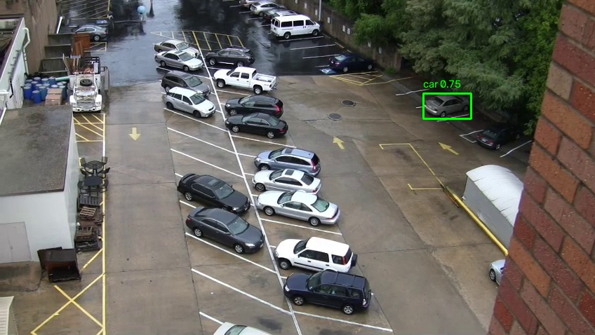<br>**evt_002** — car, 74.57%, 2026-10-14 21:55:58 |
| 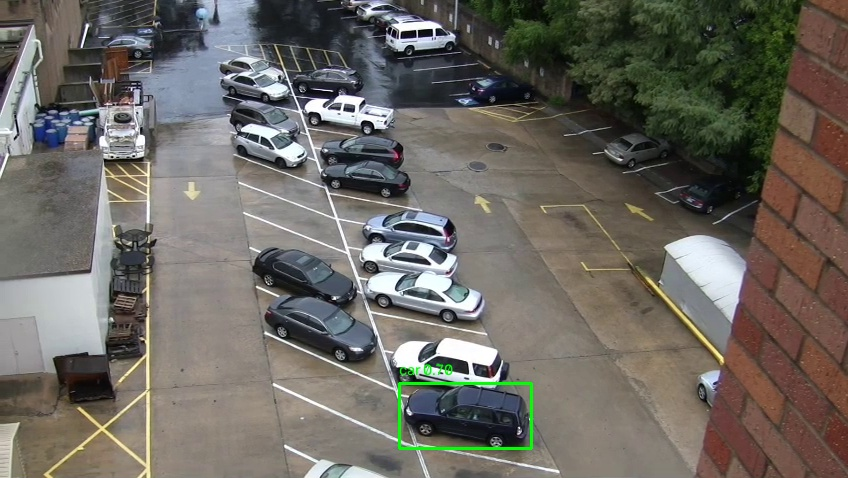<br>**evt_003** — car, 69.57%, 2026-10-14 21:55:58 | 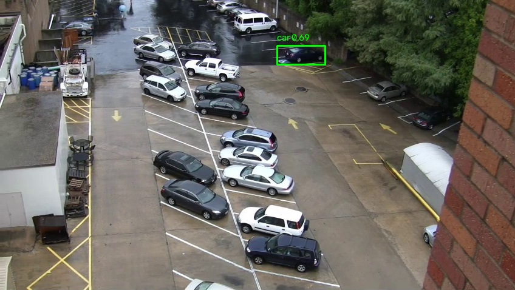<br>**evt_004** — car, 69.28%, 2026-10-14 21:55:58 |
| 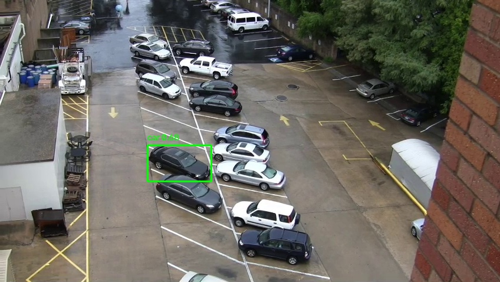<br>**evt_005** — car, 67.68%, 2026-10-14 21:55:58 | 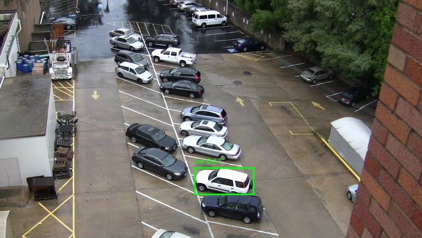<br>**evt_006** — car, 67.42%, 2026-10-14 21:55:58 |
| 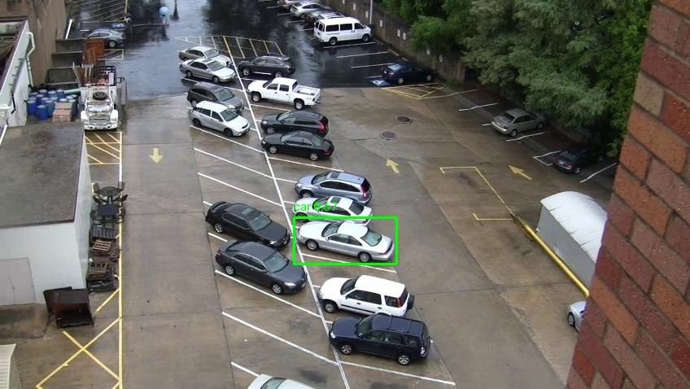<br>**evt_007** — car, 66.79%, 2026-10-14 21:55:58 | 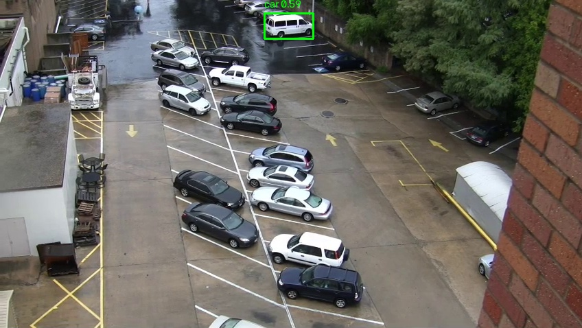<br>**evt_008** — car, 59.50%, 2026-10-14 21:55:58 |
| 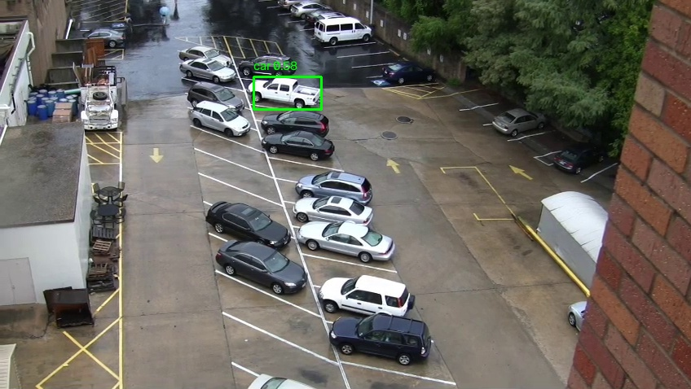<br>**evt_009** — car, 57.79%, 2026-10-14 21:55:58 | 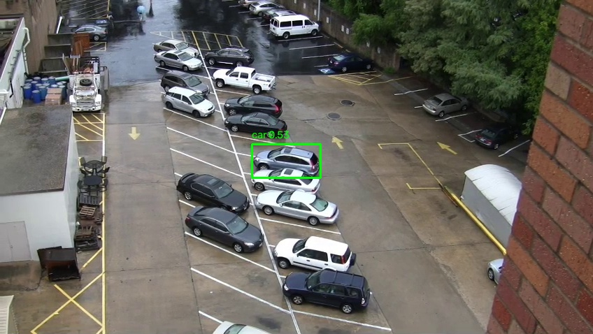<br>**evt_010** — car, 53.45%, 2026-10-14 21:55:58 |
| 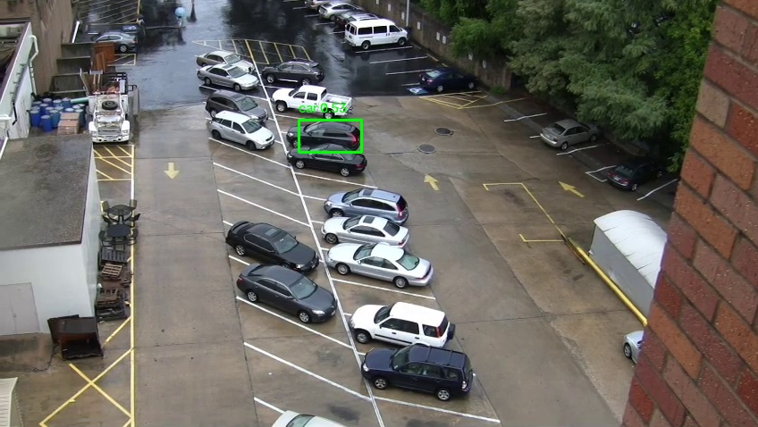<br>**evt_011** — car, 52.75%, 2026-10-14 21:55:58 | <br>**evt_012** — car, 52.61%, 2026-10-14 21:55:58 |
| 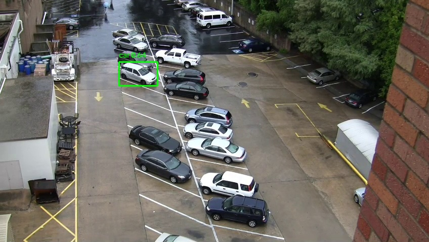<br>**evt_013** — car, 64.09%, 2026-10-14 21:55:59 | 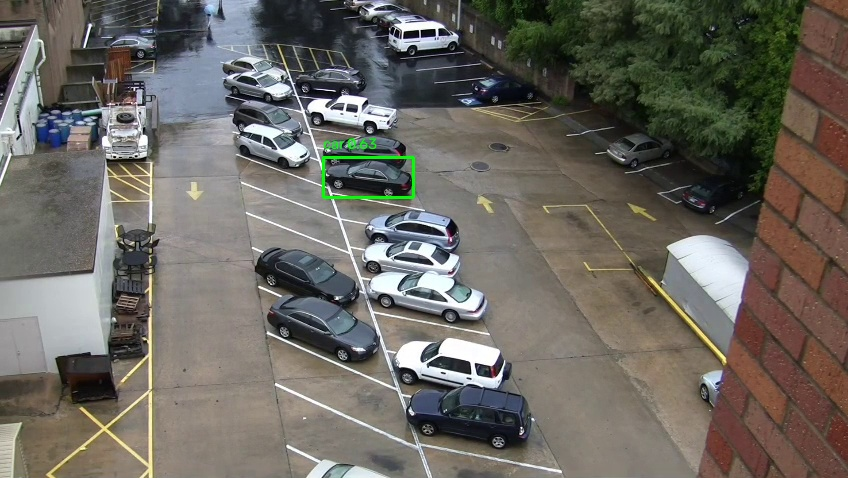<br>**evt_014** — car, 63.50%, 2026-10-14 21:55:59 |

## Optional hosted OpenAI answers

OpenAI is optional and may incur charges; the local Ollama mode is recommended
for the free demo. To use OpenAI, provide a valid key in your local terminal
session and ensure the account has API quota. Never paste a key into chat,
source code, or this README. On macOS/zsh, enter it without echoing:

```zsh
read -s "OPENAI_API_KEY?Paste API key (input hidden): "
echo
export OPENAI_API_KEY
.venv-macos/bin/python -m src.rag_answer \
  "What vehicles were detected?" \
  --provider openai \
  --db ./demo_chroma_db
unset OPENAI_API_KEY
```

OpenAI is the default provider if `--provider` is omitted. A missing key or
provider error is reported; the program does not substitute a fake answer.
Never commit API keys. Revoke any key accidentally shared.

## Windows notes

The existing Windows virtual environment can be used from PowerShell:

```powershell
.\.venv\Scripts\python.exe -m pip install -r requirements.txt
.\.venv\Scripts\python.exe -m unittest discover -s tests -v
.\.venv\Scripts\python.exe -m src.vector_store --db .\demo_chroma_db
.\.venv\Scripts\python.exe -m src.retrieve_events "Show me cars detected in the video" --db .\demo_chroma_db
.\.venv\Scripts\python.exe -m src.rag_answer "What vehicles were detected?" --provider ollama --db .\demo_chroma_db
```

Install/open Ollama for Windows and run `ollama pull qwen3:4b` before using
the Ollama provider.

## Troubleshooting

- **`ModuleNotFoundError` on macOS:** use `.venv-macos/bin/python`, not the
  system `python3`; install requirements into that environment.
- **Ollama connection refused:** open the Ollama app and leave it running.
- **Ollama model missing:** run `ollama pull qwen3:4b`, then verify with
  `ollama list`.
- **Empty Chroma index or no events:** rebuild with
  `.venv-macos/bin/python -m src.vector_store --db ./demo_chroma_db`; ensure
  event thumbnails exist.
- **OpenAI HTTP 401/429:** the optional hosted API needs a valid key and
  available account quota/billing. Use `--provider ollama` for local answers.
- **LibreSSL or slow-image-processor warning:** these dependency warnings did
  not prevent the tested retrieval or local-answer flow from working.

## Deployment scope

This project currently runs as a local command-line demo. It does not include
a web UI, public hosting, authentication, or multi-user support. A public
deployment would require a web interface/API, persistent storage, access
controls, deployment configuration, and testing on the chosen host. Do not
expose the local Ollama service publicly without appropriate security controls.


